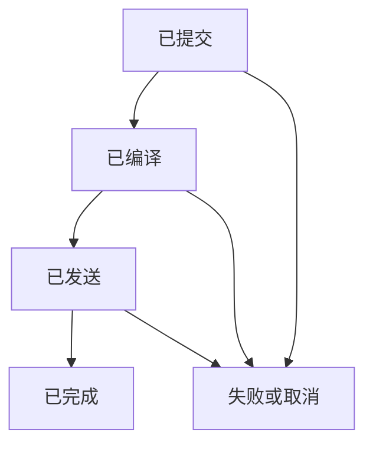

# LocalMind 上下文流转设计

> 历史设计说明：下文是开发前草案，其中“尚无运行时实现”等陈述只对应当时状态。当前已有运行核心及只读 MCP；0.5 的共享投影与预算 recall 见 [docs/ARCHITECTURE_0.5.md](docs/ARCHITECTURE_0.5.md)，实际生命周期、恢复与预算语义以 [docs/PROTOCOL.md](docs/PROTOCOL.md) 为准。原生 Hooks、通用自然纠正及真实云端接入仍需分别验收。

状态：开发前的协议设计草案。它补充 ARCHITECTURE.md，并明确 Event、回合、线程、当前状态与派生记忆如何贯通。当前尚无运行时实现。

## 1 三种上下文必须分开

| 对象 | 保存什么 | 谁控制 |
|---|---|---|
| 完整经历 | 原始消息、可观察结果、来源与时间 | 本地事件存储；正常处理不被摘要覆盖，授权遗忘例外 |
| 当前工作状态 | 目标、有效约束、已确认决定、可信进度、未决事项 | 本地程序的版本化物化视图 |
| 本轮模型输入 | 当前原话、适用状态、必要近期问答、相关证据 | 上下文编译器；原生宿主的既有历史需另计 |

持久记忆不是每轮全部加载的 prompt。检查点不是聊天摘要的另一个名字，也不是模型隐藏思维的备份。模型可变化，但原始经历、明确任务状态和来源仍由本地持有。

## 2 身份与生命周期

| 标识 | 语义 |
|---|---|
| project_id | 注册的项目范围，不能仅靠模型猜测 |
| logical_session_id | 用户看到的一段连续对话；可跨进程重启 |
| task_id | 当前目标，可跨多个逻辑会话 |
| turn_id | 一次用户输入驱动的回合；可有多个发送尝试 |
| request_id / attempt_id | 一次实际请求/重试，避免将重复回答当新经历 |
| remote_thread_id | 厂商持有的远端线程；与逻辑会话、任务不是一回事 |
| context_id | 本次已编译的上下文快照及发送材料 |
| event_id / root_source_ids | 当前事件与其独立原始依据，用于追溯、失效和去重 |

P0 同一逻辑会话只运行一个普通前台回合，其他输入排队；明确纠正优先提交并令受影响在途运行过时。由能力报告决定 steer、interrupt 或下轮重发。接收到纠正不代表能撤回已发送内容。

原始输入在内存中收到后，先检查采集生命周期。仅 active 时用 dedupe_key 原子持久化 Event 与 TurnRun；pausing/paused 不写原文、回答或派生物，至多保存必要控制元数据。持久化之前不得向用户声称“已记住”。事务完成后才确认增强回合已接收；客户端以相同键重试时不创建重复事件。

回合的发送生命周期：

freshness（current / superseded / forgotten）单独记录，不与网络生命周期混成一个终态。已发送回答可以完成，但已被新纠正 supersede 的运行不能更新当前 last_result。远端结果未知时记录 outcome_unknown，不自动重发；先尝试受支持的状态核对。

流式片段是暂存展示，最终消息按 request_id + message_id 去重后才进入完整事件。不能把每一片段、宿主重发和父子代理复述各算一条独立经历。

## 3 每轮同步过程

1. 先检查采集状态，仅 active 时保存当前用户原话；pausing/paused 不进入后续增强与记忆回写。可确定的事项纠正与 Event 在同一事务更新：有效版本增加、旧结论屏蔽、依赖失效。无法唯一对应事项但已识别冲突候选时登记 pending_conflict，并抑制该候选集合，不扩大到无关事项；完全无法定位则记 unknown、保留原话，不能声称已经修订或精确抑制，影响结果时先消歧。
2. 取得 snapshot：绑定项目/任务、相关范围版本、当前事项版本、policy_revision、capture_epoch、deletion_epoch。加入最近已提交但尚未整理的事件，避免后台延迟造成遗忘。
3. 先按授权、状态、有效期过滤，再检索当前状态、必要近期问答、实体/别名、关键词及可选向量。缓存键至少包含范围、查询与相关版本；每次命中仍核对当前删除/失效状态。
4. 最多一次前台小模型调用，提供有界候选，返回信息需要、指代候选、查询词、选择及可选压缩。模型可返回“无关记忆无需补充”或 unknown，不能编造缺失资料。
5. 一次确定性补检索，展开必要依赖。新增材料直接摘录，不再为了压缩循环调用小模型。校验原文、数字、否定、适用条件、来源与有效结论版本。
6. 程序按优先级编译，并检查预算。原始请求和有效关键约束优先；条件依赖不能被单独裁掉。可选项不完整则舍弃，必需内容装不下则 BUDGET_INSUFFICIENT。
7. 入发送队列前复查 snapshot；出队、实际调用适配器前再查一次当前范围/事项版本、暂停与删除状态。尚未发送的失效包撤销或重编译，不能继续出队。最后复核到远端接收之间仍可能发生新纠正，这个竞态不能靠数据库事务消除；已发送的运行才触发 freshness 更新与受支持的中断/转向策略。
8. 回答与请求、来源和 snapshot 关联存储。只有仍有效、未暂停、未删除且可验证的结果才能改变当前状态。助手文本、用户确认与工具结果按各自身份处理。
9. 后台抽取候选、合并重复、更新概览和经验，提交时统一校验版本屏障；旧结果丢弃或重排，不能反向恢复旧结论。

本地模型超时或非法输出时回退规则检索和原文；不自动增加云端调用。纠正语义解析失败不应阻止本轮原话送达，但不能假称本地状态已正确理解了全部要求。

## 4 最小契约需要冻结哪些字段

这些是内部协议建议，不是已实现 API。接手者将其冻结为版本化 JSON Schema / typed models，并补语义验证器；不直接改变厂商协议。

| 契约 | 最少内容 |
|---|---|
| Event | ID、接收序号、dedupe_key、scope、actor、origin_kind、父事件/回合、原始内容、发生/导入时间、根来源、generated_context_id |
| TaskState | 目标、有效事项与 revision、确认状态、可信结果、未决冲突、工作区标识/版本 |
| TurnRun | turn/request/attempt/context IDs、输入事件、snapshot、远端线程、生命周期、freshness、耗时/usage、失败或未知结果 |
| ContextPacket | 原始请求、适用状态、必要近期问答、记忆/证据、未知项、预算、依赖校验结果；本地审计不全部外发 |
| Checkpoint | 逻辑会话/任务绑定、目标、有效约束、最后可信结果、未决项、必要问答、选项结构、工作区版本、生成依据 |
| Handoff（预留） | 明确目标、允许读取的子范围、必要约束、证据引用、检查点版本、预期产物与父回合；不携带全部用户画像 |

snapshot 不应只有 task_revision。项目要求、全局偏好、删除或暂停也可能在任务不变时更新；每次外发和后台写入要统一检查受影响的范围/事项版本与 epoch。避免“一处忘了检查”的分散实现。

## 5 来源与真实消息角色

authority 是本地来源分类，不能授权改变消息优先级。提取器也不能通过输出 user_stated 为自己声明更高权威。

| 数据 | 本地语义 | 外发处理 |
|---|---|---|
| 当前用户原话 | 本轮请求/纠正 | 自控入口原样作为当前 user message；原生 Hook 不重复 |
| 历史用户要求 | 有范围、有效期和修订链的陈述 | 附来源与状态；服从当前用户明确修改 |
| 程序运行规则 | 由应用代码持有的固定规则 | 只使用宿主实际支持的可信指令位置 |
| 当前状态摘录 | 程序依据有效来源构造 | 有限模板与来源；不能把所有历史原文塞进高权限消息 |
| 助手建议/方案 | 提议或推测 | 保留身份；“方案二”尚未被选中时不是已确认决定 |
| 工具结果 | 在指定环境/版本下观察到的结果 | 只证明实际覆盖条件，不能自动泛化 |
| 网页/文件/旧摘要 | 资料或派生物 | 作为有边界的数据或受控工具结果，不提升为系统指令 |

硬约束必须有真实用户来源、active 状态、有效事项版本及适用范围。导入历史用户日志时保留原始 actor 与可追溯消息；普通文件里写“用户已同意”不构成用户指令。inferred 或 candidate 进入 active_constraints 时必须拒绝或降为候选。

Hook 可能以较高权限承载附加材料，因此仅输出程序允许的有限状态；外部原文优先通过较低权限的数据/工具通道提供。标签、转义和来源注释不能证明提示注入已经被解决，必须做对抗回放。

## 6 怎样压缩而不破坏连续理解

不能只保存“项目目标 + 最终摘要”。当用户说“选第二个”，需要上一轮选项内容与顺序；说“照刚才那个参数”时需要对应数值和单位。因此保留有界的必要近期用户/助手原文，或有来源的结构化选项，且始终区分提议与确认。

检查点保存任务事实和必要问答，不保存隐藏推理轨迹。近期窗口不按固定条数盲删；优先保留未决指代、尚待确认的选项、最新纠正和结果依据。更老信息通过分区记忆检索恢复。

分层使用“候选索引 → 当前状态/主题概览 → 原始证据”。索引主要用于本地导航；概览校验后可直接外发；关键约束、参数、否定和例外必须有必要原文。只有真正存在远端可调用的展开通道，才可把可选材料替换为纯 ID。

SourceDependency 除原始 event_id/hash，还记录 Memory 或 subject_key 的 effective_revision。纠正不改写旧 Event，而是使旧结论与依赖它的概览失效。历史查询可在明确的历史时间范围读取旧状态，当前请求默认读取有效状态。

关系 requires / qualifies 用来保留条件。例如“允许修改”依赖“已验证备份可恢复”；不能压缩成孤立许可。依赖展开有深度、数量及预算上限；循环、缺失或超限时降级或失败，不能伪装成完整上下文。

## 7 三种入口的传递边界

| 模式 | 本地可控制的部分 | 首版验收 |
|---|---|---|
| 自控消息入口 | 自己提交的应用消息、检查点和补充 | 下一用户回合不继承旧完整历史；必要状态由本地重建 |
| 原生 Hooks | 文档支持事件中的补充与捕获 | 每轮/换会话/compact 后是否触发、同步时机、大小限制和失败行为 |
| 仅 MCP | 宿主调用时的检索与展开结果 | 来源、范围与预算；不能保证每轮回答前主动调用 |

每个“新线程”都要核验是否隐式恢复旧 session、父线程或 previous response。只见新的 thread_id 不等于旧历史被排除。实际系统提示、工具定义或宿主内部内容未必可见，因此 context_ownership=full 只指应用对话历史，不等于拥有整个模型请求。

压缩必须观察实际受控消息：旧完整历史链退出、新状态进入、必要近期问答仍在。平台只暴露增量输入或不透明用量时标明可观测范围，不能声称知道全部 prompt。

同一回合中未完成的工具调用与返回必须成对保留，不在中途随意切线程。换线程只在稳定边界进行；检查点不重放外部动作，也不生成孤立的旧 tool_call_id。P0 禁用自主动作，将工具限制在受控记忆读取；不能靠 read-only 沙箱或“不要调用”的提示代替工具白名单/禁用能力。

## 8 前后台、暂停、遗忘与重启

后台任务携带输入来源与相关事项版本、scope、capture_epoch 和 deletion epoch。提交前用一个统一判定核对；只读检索缓存和待发包也要检查当前屏蔽状态。后端的最终一致性不能延迟用户纠正生效。

暂停提交后，旧 epoch 的采集、整理和在途回答不得写入记忆；新输入也不入库，恢复默认不补采期间内容。自控入口默认不启动增强回合；若另有明确展示的普通聊天直通路径，不使用 LocalMind 记忆且不写入其存储，但不能宣称宿主或云端也不保存。遗忘先屏蔽原文及依赖物，再清理摘要、索引、缓存、审计原文副本和排队结果。已经发送到云端的材料无法本地撤回，旧远端线程要停止复用。

日志默认保存 ID、状态和 hash；需要验证原文的回放使用合成材料。产品的受控原文审计也属于遗忘范围，不能因“只是调试日志”继续保留副本。备份恢复先合并删除清单。

重启从已提交事件恢复，不把写入失败称为“已记住”。已发送但远端完成状态未知的回合先核对；无可靠状态则展示 unknown，不自动重放请求或未知完成的外部动作。

## 9 回声与多执行器交接

记录生成的 context_id、来源清单和正文 hash。捕获时根据真实消息来源与已登记的生成块识别回声，不能只凭用户文本恰好包含某标签就删掉其原话。助手复述同一根来源不增加独立证据次数。

默认只在单个实际请求内去重。干净线程的下一轮仍要重新携带关键约束，不能因上轮发过就省略。

P0 不实现多 agent 调度。只预留 Handoff 字段，让以后传递的是子任务、必要证据和受限授权范围。子执行器报告“测试通过”时，还需要命令、实际结果和工作区版本；其报告先是待核验观察，不能升级为用户要求或本工作区已验证成功。父子重复引用同一来源仍是一份证据。

## 10 首批必须实现的验收

| 场景 | 检查请求与状态的要求 |
|---|---|
| 换线程选择方案 | 上轮三方案，下轮“第二个”；新请求含必要选项和身份，旧完整链未继承 |
| 纠正与后台竞争 | 旧整理先启动，纠正先提交，旧整理晚返回；旧值和旧摘要都不能恢复 |
| 多范围更新 | task 不变但项目约束/全局偏好改变，缓存与待发包不能继续用过时版本 |
| 结构正确但权威错误 | inferred/candidate、无真实用户来源的硬约束被拒绝 |
| 提交与发送处崩溃 | 重启不丢事件、不重复最终消息，未知远端结果不自动重发 |
| 暂停与排队失效 | 暂停期间新内容不采集；入队后发生纠正/遗忘/暂停，出队前撤销或重编译 |
| 删除与晚到展开 | 原文删除后，派生摘要、缓存、expand 和在途结果均受屏蔽 |
| 条件与预算 | “允许修改”不能丢“先验证备份”；必要条件装不下时明确失败 |
| 回声与跨项目 | 生成上下文不变新事实；伪造模型 project_id 不能扩大范围 |

使用同一合成经历贯通 event → snapshot → context → actual request → response → memory → next context。每个节点都有可检验记录。原有 42 条场景继续作为开发种子，这张表是新增协议验收要求，不表示已运行或通过。

## 11 架构准备产物

接手者首先输出 capability-report、最小契约、状态机与关键决策记录：一个真实入口、消息映射、线程策略、工具暴露方式、版本屏障、预算和失败行为。然后实现事件/状态存储与规则编译器，不要求先做复杂界面或完整外部记忆平台。

相关机制的上游来源：OpenViking [分层上下文](https://docs.openviking.ai/en/concepts/03-context-layers)、[检索规划](https://docs.openviking.ai/en/guides/01-configuration)、[接入能力](https://docs.openviking.ai/en/agent-integrations/16-capability-reference)；[claude-mem](https://github.com/thedotmack/claude-mem) 的渐进展开；[Hindsight](https://github.com/vectorize-io/hindsight) 的归纳与证据；[Graphiti](https://github.com/getzep/graphiti) 的时序。上述具体协议、取舍和验收属于 LocalMind 设计。
